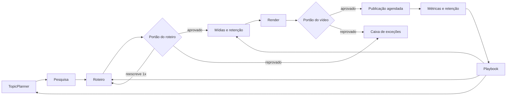

# Automação do Narra: como funciona e alternativas

Este documento descreve o piloto automático implementado e as ferramentas externas que podem ampliá-lo ou substituir partes dele. Preços e limites mudam com frequência: os valores abaixo são ordens de grandeza para comparação e precisam ser conferidos na página oficial antes de contratar.

## O ciclo implementado

| Etapa | Onde está | Com chaves | Sem chaves (fallback) |
| --- | --- | --- | --- |
| Temas | `app/learning.py` (`plan_topics`) | Azure OpenAI + vídeos populares do nicho (YouTube Data API) + desempenho do canal | modelos de pauta a partir do nicho |
| Pesquisa | `app/research.py` | Tavily (3 a 6 artigos), YouTube Data API (5 a 10 vídeos) + legendas (`youtube-transcript-api`) ou áudio transcrito no Azure; dossiê com citações pelo LLM | dossiê local com frases dos artigos encontrados |
| Roteiro | `app/writer.py` | LLM com dossiê, playbook e idioma do projeto; cada afirmação cita fatos do dossiê | modelo local (pt ou en) |
| Portão do roteiro | `app/gates.py` | LLM crítico (factualidade, gancho, ritmo, clareza, segurança) | heurística (gancho, tamanho, fontes, CTA) |
| Mídia | `app/media.py` | consultas visuais por cena (LLM), Pexels, Pixabay, Wikimedia Commons, Openverse, press kits; ranking por visão (LLM) | consultas por palavras-chave, ranking por relevância/resolução; Wikimedia e Openverse funcionam sem chave |
| Clipes curtos | `app/media.py` | `yt-dlp --download-sections` nos trechos marcados no dossiê (`FAIR_USE_CLIPS_ENABLED=true`) | desligado |
| Retenção | `app/retention.py` | regras ajustadas pelo playbook | gancho nos 3 s, troca visual a cada 2 a 4 s, clipes nas viradas, revelação perto de 60% |
| Render | `workers/pipeline` | Kokoro (pt-BR, en-US, en-GB), Ken Burns, `xfade`, áudio do clipe abaixado | manifesto JSON se não houver FFmpeg |
| Portão do vídeo | `app/gates.py` | duração, faixa de áudio, volume, tela preta, créditos, limite de uso justo | igual (só depende de FFmpeg) |
| Publicação | `app/autopilot.py` | YouTube/TikTok via OAuth da organização, agendada pela cadência | simulada |
| Aprendizado | `app/learning.py` | métricas diárias, curva `audienceRetention` do YouTube Analytics, quedas mapeadas para o shot, regras semanais + regras textuais do LLM, títulos A/B alternados entre vídeos | regras estatísticas sem LLM; curva pode ser registrada manualmente |

A plataforma fica menos dependente de você em três frentes: o agendador escolhe temas e produz na cadência, os portões aprovam sozinhos o que passa nos critérios, e o playbook reescreve os parâmetros (ritmo de cortes, duração, estilo de gancho e de título) a partir dos resultados.

## Alternativas por categoria

### Orquestração de etapas

| Ferramenta | Prós | Contras | Custo aproximado |
| --- | --- | --- | --- |
| Fila própria (Redis, atual) | zero dependência nova, já integrada | sem UI de workflow, retries manuais | só a infraestrutura |
| Temporal | workflows duráveis, retries, timers e histórico nativos; ideal para pipelines longos | mais um serviço para operar; curva de aprendizado | open source; Temporal Cloud cobra por ação |
| Inngest | funções em etapas com retries e agendamento, ótimo DX | serviço externo ou self-host | plano gratuito; pago por execuções |
| Prefect | bom para pipelines Python e observabilidade | foco em dados, não em produtos | open source; nuvem com plano gratuito |
| n8n | integrações no-code (Slack, Sheets, Drive, webhooks) para operar o canal sem programar | lógica complexa fica difícil de versionar | self-host gratuito; nuvem por execuções |

Recomendação: manter a fila atual e migrar para Temporal quando houver vários workers ou etapas que esperam horas (ex.: aguardar métricas). Use n8n para automações periféricas (avisar no Slack quando algo cair na caixa de exceções, exportar relatórios).

### Inteligência (LLM, visão, vídeo)

| Ferramenta | Uso no Narra | Observação |
| --- | --- | --- |
| Azure OpenAI (escolhido) | dossiê, roteiro, crítica, consultas visuais, ranking por visão, pauta, playbook, transcrição | cobrança por tokens; configure o preço do seu contrato em `AZURE_INPUT_CENTS_PER_MTOK`/`AZURE_OUTPUT_CENTS_PER_MTOK` |
| Azure AI Video Indexer | "assistir" vídeos inteiros: cenas, objetos, OCR, tópicos, transcrição | mesma conta Azure; útil para analisar os próprios vídeos e os de referência |
| Azure AI Content Safety | moderação extra do roteiro e das imagens | complementa o portão de segurança |
| Google Gemini | entende vídeos do YouTube diretamente pela URL | alternativa para a etapa de vídeos sem baixar áudio |

### Busca e leitura de fontes

| Ferramenta | Prós | Contras |
| --- | --- | --- |
| Tavily (implementado) | feita para agentes, devolve o texto limpo das páginas | plano gratuito limitado; pago por crédito |
| Exa | busca semântica, bom para achar artigos de qualidade | pago por requisição |
| Brave Search API | índice próprio, preço baixo | sem extração de conteúdo |
| SerpAPI | resultados do Google, YouTube, Notícias | mais caro; termos do Google |
| Grounding with Bing (Azure AI Foundry) | mesma conta Azure | integrado a agentes do Foundry, não à API de chat simples |

### Mídia licenciada

| Fonte | Licença | Chave |
| --- | --- | --- |
| Pexels (implementado) | uso livre, crédito recomendado | gratuita, com limite por hora |
| Pixabay (implementado) | uso livre | gratuita |
| Wikimedia Commons (implementado) | CC/domínio público, crédito obrigatório | não precisa |
| Openverse (implementado) | agregador CC, filtramos uso comercial | não precisa (com limite) |
| Press kits oficiais (implementado) | material liberado por estúdios e marcas | URLs nas configurações do piloto |
| Unsplash | uso livre, exige atribuição e "hotlink" | gratuita |
| Storyblocks, Envato, Getty | catálogos profissionais | assinatura/licença por item |

Para temas de jogos (ex.: Destiny 1), os press kits das publicadoras e capturas próprias de gameplay são as fontes mais seguras. Trechos de vídeos de terceiros (`FAIR_USE_CLIPS_ENABLED`) ficam limitados a 8 s por clipe e 20% do vídeo, sempre com crédito, mas ainda podem gerar reivindicações de Content ID. O download com `yt-dlp` viola os termos de uso do YouTube: use apenas quando houver justificativa editorial e aceite o risco. Para YouTube, o `yt-dlp` recente pode exigir um runtime JavaScript (ex.: Deno) no worker.

### Montagem e edição

| Ferramenta | Prós | Contras |
| --- | --- | --- |
| FFmpeg (atual) | grátis, local, controle total | efeitos avançados exigem filtros complexos |
| Remotion | vídeos em React: tipografia animada, gráficos, templates | licença paga para empresas acima de um porte |
| Shotstack / Creatomate | APIs de render na nuvem com templates | pago por minuto renderizado; mídia sai da sua infraestrutura |

### Voz

| Ferramenta | Prós | Contras |
| --- | --- | --- |
| Kokoro (atual) | local, grátis, pt-BR, en-US e en-GB | menos expressivo que vozes comerciais |
| Azure AI Speech | centenas de vozes neurais en-US/en-GB/pt-BR, SSML, mesma conta Azure | pago por caractere |
| ElevenLabs | vozes muito naturais, clonagem com consentimento | caro em volume; exige consentimento para clonar |

### Miniaturas e títulos

Gere thumbnails com o modelo de imagem do Azure OpenAI a partir do gancho do roteiro e teste variações. O YouTube oferece "Testar e comparar" de miniaturas no Studio, mas não por API; por isso o Narra alterna os estilos de título entre vídeos e compara os resultados no playbook.

### Referências de mercado

Pictory, InVideo AI e Opus Clip mostram o estado da arte de vídeo automatizado (roteiro para vídeo, cortes de vídeos longos, legendas animadas). Vale observar como eles resolvem legendas dinâmicas e cortes de ritmo, que são os próximos ganhos de retenção mais baratos.

## Próximos passos sugeridos

1. Thumbnails automáticas com variação A/B por estilo.
2. Legendas palavra a palavra com destaque (karaokê) e emojis, que costumam aumentar a retenção em vídeos curtos.
3. Azure AI Video Indexer para analisar a retenção dos próprios vídeos cena a cena e alimentar o playbook com mais sinais.
4. Temporal para orquestração quando houver vários workers.
5. Notificações (Slack/e-mail via n8n) quando algo entrar na caixa de exceções.
